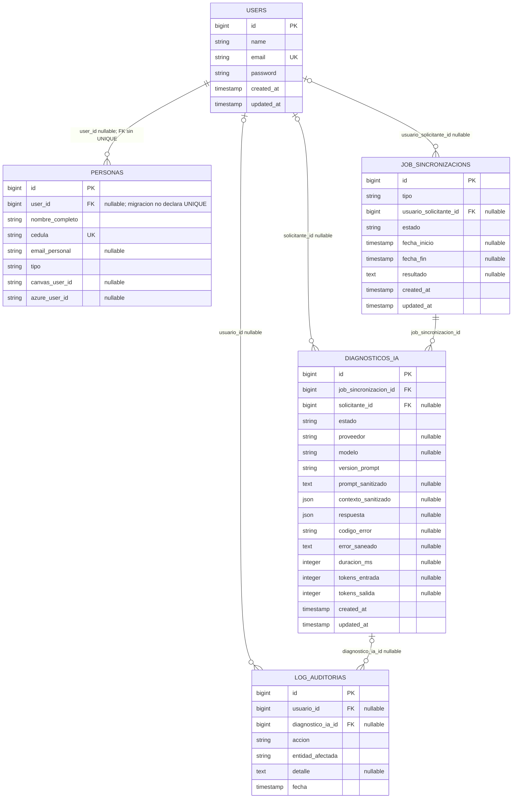

# ERD — Diagnóstico asistido por IA

**Estado:** modelo, migración y relaciones de persistencia implementados; panel e invocación asíncrona aún pendientes.  
**Alcance:** entidades existentes directamente relacionadas con la sincronización y la nueva entidad de diagnóstico. El resto del modelo académico no cambia.  
**Fuente del estado actual:** migraciones y modelos existentes del proyecto.

`NullLLMClient` es un simulador en proceso sin transporte externo y no requiere tablas propias. Solo se persisten en Laravel los diagnósticos y su historial; el valor de `proveedor` identifica `simulado`.

## 1. Diagrama

> En Mermaid, `o|` indica que la clave foránea puede ser nula y `o{` representa cero o muchas filas. La migración de `personas` no declara `UNIQUE` para `user_id`, aunque el modelo Eloquent expone `User::persona()` como `HasOne`; el ERD refleja la restricción real de base de datos. Si el negocio exige uno-a-uno estricto, habrá que evaluar y añadir una restricción única en un cambio posterior.

## 2. Estado y relaciones

| Relación | Estado | Regla |
|---|---|---|
| `User` 1 — 0..N `Persona` por restricción de BD | Existente | `personas.user_id` es nullable y referencia `users` sin índice único; Eloquent lo modela como `HasOne`. Una persona aspirante puede no tener credenciales. |
| `User` 1 — 0..N `JobSincronizacion` | Existente | `usuario_solicitante_id` nullable; al eliminar usuario, la FK conserva el job y deja el solicitante en `null`. |
| `User` 1 — 0..N `LogAuditoria` | Existente | `usuario_id` nullable; al eliminar usuario, la auditoría se conserva con actor nulo. |
| `JobSincronizacion` 1 — 0..N `DiagnosticoIA` | Implementada | Cada diagnóstico pertenece a un job; los intentos repetidos se guardan como filas independientes y se restringe el borrado del job relacionado. |
| `User` 1 — 0..N `DiagnosticoIA` | Implementada | `solicitante_id` nullable para ejecuciones no iniciadas por una sesión humana o si el usuario se elimina. |
| `DiagnosticoIA` 1 — 0..N `LogAuditoria` | Implementada | `diagnostico_ia_id` es FK nullable; al eliminar el diagnóstico, el log se conserva con la FK a `null`. |
| `DiagnosticoIA` — `Persona` | Sin FK propuesta | Los resultados de consultas de contexto deben guardar indicadores mínimos y saneados, no asociar ni copiar identificadores personales innecesarios. |

La FK propuesta `job_sincronizacion_id` debe preservar la trazabilidad del diagnóstico. Se recomienda restringir el borrado físico del job mientras existan diagnósticos, o mantener la política de retención coordinada; no usar borrado en cascada que elimine auditoría de forma inadvertida. La columna `solicitante_id` puede usar `nullOnDelete`.

## 3. Diccionario de la entidad propuesta

Tabla: `diagnosticos_ia`; modelo sugerido: `App\Models\DiagnosticoIA`.

| Campo | Tipo sugerido | Nulo | Descripción / regla |
|---|---|---:|---|
| `id` | bigint, PK | No | Identificador interno. |
| `job_sincronizacion_id` | FK a `job_sincronizacions.id` | No | Job que se analiza; la aplicación solo admite jobs en estado `error`. |
| `solicitante_id` | FK a `users.id` | Sí | Usuario Admin TI que inició la solicitud; nullable para ejecución de sistema y eliminación del usuario. |
| `estado` | enum/string con validación de aplicación | No | `pendiente`, `en_proceso`, `completado` o `error`. |
| `proveedor` | string | Sí | Identificador del adaptador; para el simulador en proceso, `simulado`. |
| `modelo` | string | Sí | Identificador informativo; en simulación, `mock-gpt`. No almacenar credenciales ni cabeceras. |
| `version_prompt` | string | No | Versión identificable de la plantilla y esquema de salida. |
| `prompt_sanitizado` | text | Sí | Prompt renderizado después de saneamiento, únicamente si la política de retención lo permite. No guardar el prompt con datos sin filtrar. |
| `contexto_sanitizado` | JSON | Sí | Solo categoría técnica allow-list y código HTTP reconocido. No incluye mensaje libre, IDs, tipo/estado del job ni datos de Persona. |
| `respuesta` | JSON | Sí | Respuesta validada con el esquema del PRD; nula si aún no terminó o falló. |
| `codigo_error` | string | Sí | Categoría técnica estable (timeout, provider_unavailable, invalid_response, etc.), sin secretos. |
| `error_saneado` | text | Sí | Descripción técnica segura para soporte; no almacenar payloads de proveedor que contengan secretos o información personal. |
| `duracion_ms` | integer | Sí | Duración de la invocación cuando se pueda medir. |
| `tokens_entrada` | integer | Sí | Uso informado por un proveedor real, si está disponible; nulo para el mock. |
| `tokens_salida` | integer | Sí | Uso informado por un proveedor real, si está disponible; nulo para el mock. |
| `created_at`, `updated_at` | timestamps | Según convención | Tiempos del registro y actualización del estado. |

El servicio no copia ni envía el texto original del error: lo reduce en memoria a categoría técnica y código HTTP allow-list. El prompt persistido contiene solo esos campos. La respuesta se valida, limita al esquema permitido y enmascara antes de guardarse. Los registros previos de sincronización/auditoría no se modifican retroactivamente.

## 4. Índices y restricciones recomendados

- Índice compuesto `(job_sincronizacion_id, created_at)` para mostrar intentos de un job en orden cronológico.
- Índice `(estado, created_at)` si se necesita una cola operativa de diagnósticos pendientes o fallidos.
- Índice `(solicitante_id, created_at)` para filtros del historial, solo si el volumen/consulta lo justifica.
- FK de `job_sincronizacion_id` a `job_sincronizacions.id` con `restrictOnDelete`.
- FK nullable de `solicitante_id` a `users.id` con `nullOnDelete`.
- FK nullable de `log_auditorias.diagnostico_ia_id` a `diagnosticos_ia.id` con `nullOnDelete`.
- Validar en el servicio y no solo en la interfaz que el job esté en estado `error`.
- Mantener varios registros por job para permitir regenerar un diagnóstico y preservar el historial.

## 5. Contexto local permitido

El backend puede consultar, con herramientas/servicios tipados y de solo lectura, los datos necesarios para el diagnóstico:

- Datos operativos del job: tipo, estado, fecha y mensaje/código de error saneados.
- Estado o identificadores técnicos de integración que no sean credenciales, solo si aportan valor y se aprueban.
- Existencia/estado de una persona en el directorio local como indicador mínimo (`existe`, `estado_categoria`); no enviar identificadores personales completos al LLM.
- Último job relacionado, cuando la relación esté determinada sin ambigüedad y sea relevante.

El modelo no debe recibir conexión SQL ni seleccionar libremente filas. Las herramientas devuelven estructuras limitadas, no ejecutan escrituras y aplican autorización y saneamiento en el servidor.

## 6. Correlación de auditoría

`LogAuditoria` registra actor, acción, entidad afectada, detalle, fecha y la nueva FK nullable `diagnostico_ia_id`. Para cada solicitud, inicio, finalización o error se registra una acción diferenciada. El detalle contiene estado/código técnico permitido; no duplica el prompt ni la respuesta.

El job de sincronización original sigue siendo la fuente de verdad para el resultado de Canvas/Teams. El registro de diagnóstico documenta una interpretación posterior y no debe actualizar `job_sincronizacions.resultado`.

## 7. Entidades existentes relacionadas

- `job_sincronizacions`: tabla existente; enum de tipo (`alta_usuario`, `crear_curso`, `crear_team`, `matricula`, `baja`), estado (`pendiente`, `en_proceso`, `completado`, `error`), solicitante, fechas y resultado.
- `log_auditorias`: tabla existente; actor, acción, entidad afectada, detalle y fecha.
- `users`: autenticación y autorización del panel; el rol institucional se determina a través de la persona vinculada.
- `personas`: directorio institucional relacionado opcionalmente con `users`; contiene información personal que no debe replicarse sin motivo en el historial de IA.

El resto del MER académico (cursos, inscripciones, equipos y miembros) permanece fuera de este ERD de alcance acotado y no requiere cambios para registrar diagnósticos.
